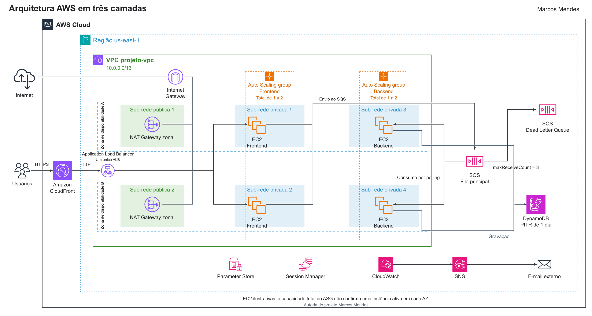
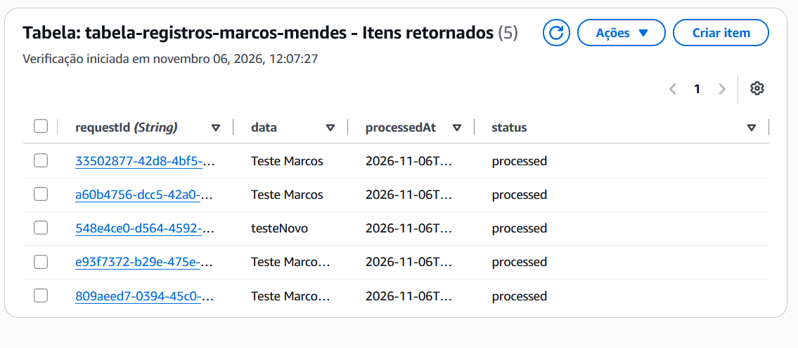
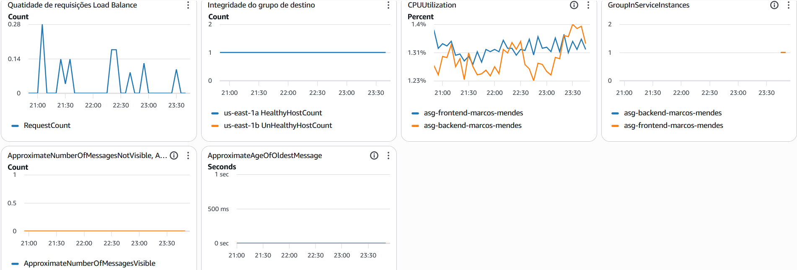

# Arquitetura em três camadas na AWS

**Autoria do projeto Marcos Mendes**

Laboratório de uma aplicação web com processamento assíncrono. Construí e explorei uma arquitetura que recebe solicitações em EC2, desacopla o trabalho com SQS e persiste os resultados no DynamoDB. Este repositório reúne o desenho da solução, as evidências e as decisões do projeto.

Prática realizada no contexto dos meus estudos na Escola da Nuvem, a partir da Semana de Arquitetura da AWS.

## Diagrama da arquitetura

[Abrir imagem em alta resolução](assets/arquitetura/arquitetura-estilo-referencia.png) · [Abrir versão vetorial](assets/arquitetura/arquitetura-estilo-referencia.svg) · [Editar no diagrams.net](assets/arquitetura/arquitetura-detalhada.drawio)

O diagrama mantém a organização por região, VPC, zonas e sub-redes. As conexões representam o fluxo funcional; as posições de EC2 ilustram as opções de alocação dos grupos, sem afirmar uma instância ativa em cada AZ.

## Objetivo

Entender como uma aplicação pode aceitar solicitações sem esperar o processamento terminar e como rede, capacidade, filas, dados e monitoramento se relacionam. O laboratório foi construído manualmente pelo console AWS.

## Como funciona

1. O usuário acessa o CloudFront por HTTPS.
2. O CloudFront encaminha a requisição ao Application Load Balancer. No laboratório, esse trecho usa HTTP.
3. O ALB distribui o tráfego para um frontend saudável em EC2.
4. O frontend gera um requestId e envia os dados para a fila SQS.
5. O backend consulta a fila por polling, processa a mensagem e persiste o resultado no DynamoDB.
6. A DLQ associada à fila principal recebe mensagens com falhas persistentes, conforme a política configurada.

A confirmação de envio indica aceitação pela fila. A conclusão do processamento precisa ser verificada pelo resultado persistido.

## Rede e operação

| Item | Configuração documentada |
| --- | --- |
| Região | us-east-1 |
| VPC | projeto-vpc, CIDR 10.0.0.0/16 |
| Sub-redes | Duas públicas e quatro privadas, distribuídas entre duas AZs |
| Entrada | CloudFront e um ALB associado às duas sub-redes públicas |
| Computação | Frontend e backend em EC2 privadas, com ASGs separados |
| Capacidade | Mínimo 1 e máximo 2 instâncias por grupo, no total |
| Saída privada | Dois NAT Gateways zonais, um em cada sub-rede pública |
| Mensageria | SQS Standard e DLQ com maxReceiveCount de 3 |
| Persistência | DynamoDB com PITR ativado e janela de um dia na captura |
| Acesso e configuração | IAM Role, security groups, Session Manager e Parameter Store |
| Monitoramento | Dashboard e alarmes no CloudWatch, com notificações por SNS e e-mail |

A independência de saída entre AZs depende de cada sub-rede privada usar o NAT da própria zona. A configuração de dois NATs zonais e o uso do Session Manager fazem parte do relato do projeto; as rotas não foram inspecionadas na preparação deste material.

## Evidências do laboratório

A captura mostra cinco registros na tabela. Ela sustenta a presença de itens processados, sem medir taxa de sucesso, desempenho ou ausência de duplicatas.

As capturas representam momentos do laboratório. Os arquivos públicos foram selecionados para excluir números da conta e áreas com recursos de outros participantes. A [procedência das evidências](docs/evidencias.md) explica o que cada imagem demonstra.

## Aprendizados e limites

- O ALB distribui requisições HTTP, enquanto o SQS desacopla e organiza o trabalho dos consumidores.
- Selecionar duas AZs não garante redundância simultânea quando o grupo mantém apenas uma instância.
- Backlog por instância pode orientar a escala de consumidores; a aplicação dessa política ainda não foi comprovada no projeto.
- O trecho CloudFront até ALB permanece em HTTP e as roles ainda usam permissões amplas.
- O custo mensal atribuível ao projeto, a latência, o throughput e os tempos de recuperação não foram medidos.

O documento também registra o estudo de Cost Anomaly Detection. Os valores globais de uma conta compartilhada não foram atribuídos ao custo deste laboratório.

## Próximos passos

As evoluções propostas incluem infraestrutura como código, menor privilégio, idempotência no consumidor, HTTPS na origem, logs centralizados e CI/CD. Esses itens permanecem como próximos passos; não são apresentados como implementados. O estudo de caso detalha as 18 possibilidades de evolução.

## Documentação técnica

- [Estudo de caso completo](docs/estudo-de-caso.md)
- [Conferência do diagrama e dos limites da representação](docs/validacao-diagrama.md)
- [Roteiro para reprodução manual](docs/reproducao-manual.md)
- [Plano de testes e coleta de evidências](docs/plano-de-testes.md)
- [Custos e encerramento](docs/custos-e-encerramento.md)
- [Referências técnicas](docs/referencias.md)
- [Créditos dos ícones AWS](docs/creditos-dos-icones.md)

Este é um repositório de documentação. A aplicação executável e a infraestrutura como código não integram esta versão. Não é necessário manter os recursos AWS ligados para publicar o estudo de caso.

## Créditos

Autoria do projeto Marcos Mendes. Laboratório baseado na Semana de Arquitetura da AWS, no contexto da Escola da Nuvem. A apostila original e arquivos de credenciais não fazem parte do repositório. Os símbolos do desenho pertencem ao conjunto oficial AWS Architecture Icons.
