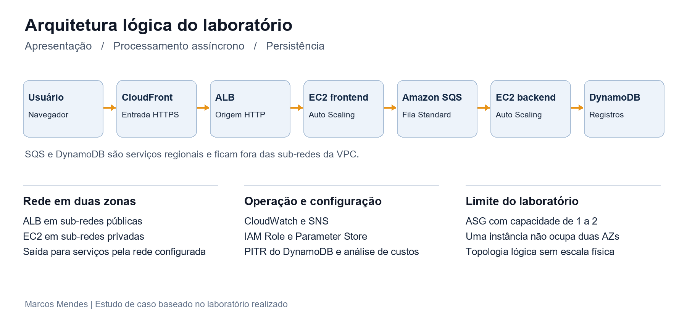
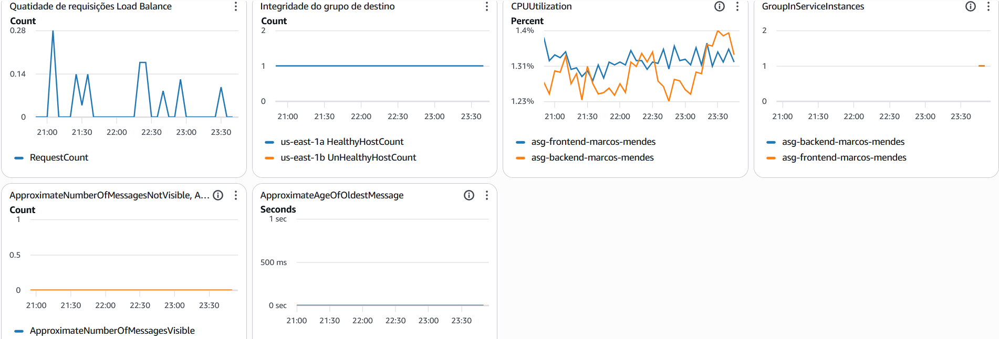
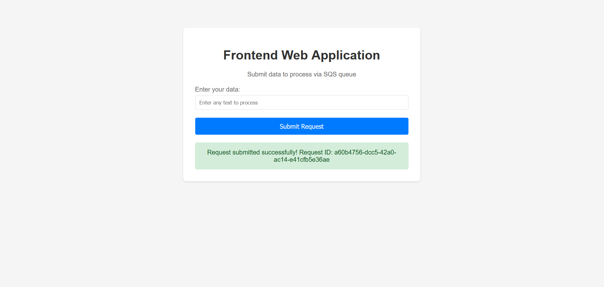
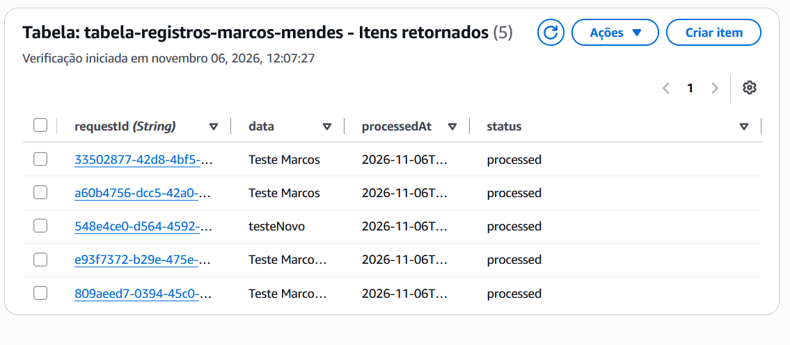
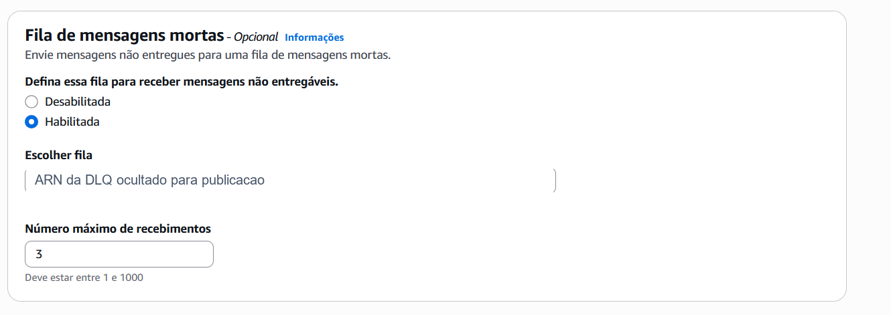
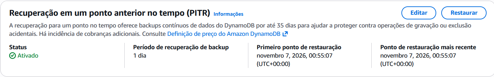
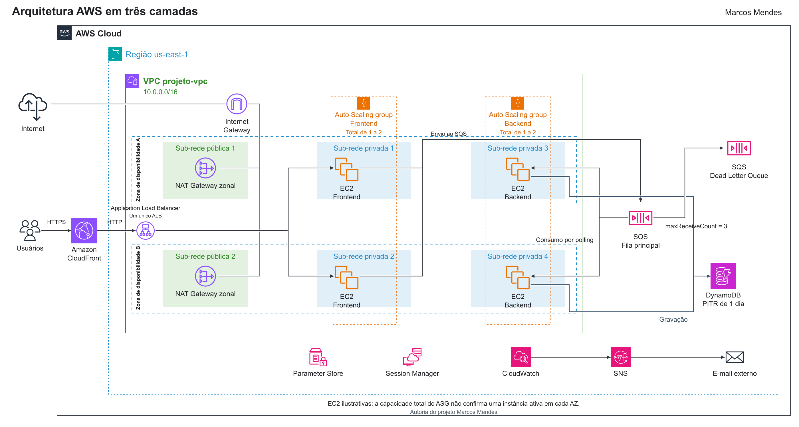

# Arquitetura em três camadas na AWS

Marcos Mendes | Estudo de caso do laboratório

## Arquitetura em três camadas na AWS

Estudo de caso de um laboratório com processamento assíncrono

Marcos Mendes | Portfólio Cloud | Novembro de 2026

Construí e explorei uma aplicação web na AWS para enviar solicitações, processá-las por meio de uma fila e persistir os resultados. O projeto reúne balanceamento de carga, instâncias EC2, Auto Scaling, SQS, DynamoDB e recursos de observabilidade e segurança.

O principal aprendizado foi entender como as decisões de rede, capacidade, processamento e monitoramento se relacionam. O relatório apresenta as configurações documentadas, as evidências preservadas e as evoluções que ainda não implementei.

Escopo da análise: registro fornecido do laboratório e relato do autor. Não foi feita inspeção da conta AWS nem nova execução dos testes. As capturas mostram estados pontuais do ambiente, sem comprovar desempenho contínuo ou disponibilidade de produção.

## Escopo e estado dos recursos

O ambiente foi montado manualmente pelo console em uma VPC distribuída em duas zonas de disponibilidade, na região us-east-1. A primeira etapa usou instâncias fixas. A evolução passou a usar Launch Templates e grupos de Auto Scaling separados para frontend e backend.

| Componente | Estado documentado |

| --- | --- |

| VPC e rede | VPC projeto-vpc, CIDR 10.0.0.0/16; duas sub-redes públicas e quatro privadas em duas AZs. O projeto utiliza dois NATs zonais. |

| ALB e EC2 | ALB público com grupo de destino; frontend e backend em instâncias privadas. |

| SQS e DynamoDB | Fila Standard, DLQ e registros processados na tabela. |

| Auto Scaling | Grupos separados; mínimo 1, máximo 2 e política de CPU com alvo de 60% no registro. |

| CloudFront | Distribuição na frente do ALB; HTTPS no acesso do usuário e HTTP até a origem. |

| Configuração e IAM | Parameter Store com String e role com permissões amplas de SQS e DynamoDB. |

| Observabilidade | Dashboard CloudWatch e alertas SNS por e-mail; há registro de alarme recebido. |

| Proteção e custos | Restrição do ALB por prefix list, PITR ativado e estudo de Cost Anomaly Detection. |

### O que exige confirmação adicional

Não há evidência suficiente para afirmar que a escala por backlog foi aplicada. O material explica a fórmula, mas o registro apresentado remete à política por CPU. A janela de PITR mostrada é de um dia. Também não há medição de RTO, RPO, throughput, latência percentil ou custo total atribuível apenas a este projeto.

## Como a solicitação percorre a arquitetura

### Apresentação

O navegador acessa o CloudFront por HTTPS. O CloudFront encaminha as solicitações ao ALB usando HTTP no laboratório. O ALB direciona o tráfego a um frontend saudável. A aplicação Python com Flask recebe o formulário e envia uma mensagem ao SQS.

### Processamento e persistência

O frontend gera um requestId e envia os dados e um timestamp no corpo da mensagem. O backend atua como consumidor da fila, processa a solicitação e grava no DynamoDB. A mensagem deve ser removida da fila somente após a persistência bem-sucedida. O registro da tabela mostra requestId, data, processedAt e status.

A resposta de envio bem-sucedido indica aceitação da solicitação pela fila. Ela não comprova que o backend terminou. A confirmação de processamento depende do registro persistido ou de uma consulta posterior ao estado da operação.

### Separação de rede

As instâncias ficam em sub-redes privadas e recebem permissões por IAM Role, sem a necessidade de chaves permanentes no código. SQS e DynamoDB são serviços regionais acessados por APIs; não são instalados nas sub-redes. O NAT atende a saída prevista no laboratório. O projeto utiliza dois NAT Gateways zonais, um em cada sub-rede pública. Para manter a saída independente por AZ, as rotas privadas devem apontar ao NAT da própria zona; as rotas não foram inspecionadas nesta revisão.

### O limite de disponibilidade

Selecionar sub-redes em duas AZs permite distribuir capacidade. Com capacidade desejada de uma instância, porém, há apenas uma instância por grupo naquele momento. Para sustentar redundância simultânea por camada, uma evolução seria mínimo e capacidade desejada de pelo menos duas instâncias, distribuídas entre as AZs, com custos e testes correspondentes.

## Construção da aplicação e da rede

A sequência abaixo resume as etapas realizadas, sem reproduzir integralmente a apostila. Os parâmetros específicos da conta foram omitidos dos materiais públicos.

### 1 Preparar persistência e fila

Criei a tabela DynamoDB e a fila SQS para desacoplar o recebimento do processamento. A tabela usa requestId como identificador dos registros observados. O frontend não precisa esperar o consumidor terminar para aceitar novas solicitações.

### 2 Definir acesso entre os recursos

Configurei um security group para o ALB e outro para as instâncias. A entrada HTTP das EC2 foi limitada ao grupo do balanceador. Associei uma IAM Role às instâncias para acesso aos serviços AWS. As políticas gerenciadas FullAccess simplificaram o laboratório e ficaram registradas como uma limitação a corrigir.

### 3 Publicar o frontend e registrar os destinos

Usei user data para instalar dependências e iniciar a aplicação Flask como serviço do systemd. As instâncias frontend foram registradas em um target group HTTP na porta 80. O caminho de health check foi /, com intervalo de 10 segundos descrito no roteiro.

### 4 Adicionar o ALB e os consumidores

O ALB foi associado às duas sub-redes públicas. Os consumidores backend foram iniciados em sub-redes privadas. O teste funcional consistiu em enviar dados pelo formulário e conferir a presença dos registros no DynamoDB.

Aprendizado: o balanceador distribui conexões HTTP do frontend; o SQS distribui o trabalho para os consumidores. O backend não precisa integrar o target group do ALB para consumir a fila.

## Evolução para operação do ambiente

### 5 Automatizar a capacidade

Criei Launch Templates e grupos de Auto Scaling para substituir o uso exclusivo de instâncias fixas. O registro descreve mínimo 1, máximo 2 e alvo de CPU em 60%. Para o frontend, houve integração com o ALB e health checks do Elastic Load Balancing. A configuração autoriza o ajuste de capacidade, mas não substitui a evidência de um evento real de escala.

### 6 Adicionar distribuição e configuração

Adicionei o CloudFront com o ALB como origem e parâmetros no Systems Manager Parameter Store. O tipo String foi usado para configuração. Segredos reais devem receber controles próprios; o custo não justifica mantê-los em texto simples.

### 7 Tratar falhas de processamento

Associei uma DLQ à fila principal, com maxReceiveCount de 3. O roteiro registra retenção de 14 dias e visibility timeout de 30 segundos para a DLQ; esses atributos pertencem à fila configurada e não devem ser atribuídos automaticamente à fila principal. Há captura de mensagem durante o ensaio, sem identificação visível da fila.

O visibility timeout reduz concorrência sobre uma mensagem, mas uma fila Standard pode entregar duplicatas, inclusive durante esse período. O processamento precisa ser idempotente. Para persistência, uma escrita condicional com requestId pode impedir a recriação do mesmo item; efeitos externos também precisam de deduplicação. [R5]

### 8 Monitorar e proteger

Reuni métricas no CloudWatch, configurei SNS para alertas por e-mail e limitei a entrada do ALB aos endereços de origem do CloudFront com uma prefix list gerenciada. Ativei PITR na tabela. O material também registra a exploração de anomalias de custo, que não equivale a um limite automático de gastos.

## Métricas que ajudam a operar o sistema

Um dashboard precisa responder a perguntas operacionais. Contagens, percentuais, segundos e latências devem usar gráficos ou eixos apropriados. As métricas abaixo incluem as que aparecem no registro e sugestões para ampliar a observação.

| Serviço e métricas | Pergunta operacional |

| --- | --- |

| ALB RequestCount, HealthyHostCount, UnHealthyHostCount | Há tráfego e destinos aptos a recebê-lo? Conferir estatística e dimensões. |

| EC2 e ASG CPUUtilization, GroupInServiceInstances | Há pressão de CPU e capacidade disponível? CPU e número de instâncias usam unidades distintas. |

| SQS ApproximateNumberOfMessagesVisible e NotVisible | Quanto trabalho espera e quanto está em processamento? São contagens aproximadas. |

| SQS ApproximateAgeOfOldestMessage | Há mensagens aguardando por tempo excessivo? Observar em segundos. |

| DLQ ApproximateNumberOfMessagesVisible | Há falhas persistentes aguardando análise? Uma mensagem já pode justificar investigação. |

| CloudFront 4xxErrorRate, 5xxErrorRate, CacheHitRate | Há falhas na borda e aproveitamento de cache? CacheHitRate é uma métrica adicional com cobrança. [R1] |

| DynamoDB ThrottledRequests, SystemErrors, SuccessfulRequestLatency | Há limitação de capacidade, falhas de serviço ou aumento de latência? Separar por operação quando aplicável. |

| DynamoDB ConsumedReadCapacityUnits e ConsumedWriteCapacityUnits | Como evolui o consumo? Relacionar ao modo de capacidade, ao tráfego e aos throttles. |

As métricas de distribuição do CloudFront são consultadas no CloudWatch em us-east-1. CacheHitRate considera requisições cacheáveis; POST não é servido do cache. Um aumento no cache hit não prova redução das escritas na fila. [R1]

## Como interpretar o dashboard e a escala

No painel, HealthyHostCount aparece com a dimensão us-east-1a e UnHealthyHostCount com us-east-1b. Essas séries não são um par equivalente para comparar a saúde das duas AZs. Uma melhoria é exibir as duas métricas para cada AZ e manter os filtros de LoadBalancer e TargetGroup consistentes.

O gráfico de RequestCount mostra valores fracionários. Isso pode ocorrer com uma estatística como Average; para contar solicitações por período, revisar e preferir Sum. O gráfico sozinho não permite concluir o volume total recebido.

### Escala de consumidores por backlog

Backlog por instância = ApproximateNumberOfMessagesVisible / GroupInServiceInstances. Exemplo didático: 20 mensagens e 4 consumidores resultam em backlog de 5 por instância. O alvo deve ser escolhido pela latência aceitável e pelo tempo médio de processamento, não por um número arbitrário. [R3]

A implementação dessa política permanece pendente de comprovação neste portfólio. Antes de aplicá-la, validar as dimensões, a coleta de métricas do grupo, os períodos compatíveis e o caso de capacidade zero. Também é necessário observar idade da mensagem, erros e tempo de processamento para avaliar se a escala resolveu o problema.

## Evidências de envio e persistência

As capturas sustentam o funcionamento observado do formulário e a presença de itens processados. Elas não demonstram, isoladamente, correlação ponta a ponta de uma requisição, ausência de duplicatas, ordenação ou taxa de sucesso. Um próximo registro deve acompanhar o mesmo requestId no envio, no processamento e na persistência.

## Evidências de falha e recuperação

A DLQ permite separar falhas persistentes do fluxo principal e preservar mensagens para investigação. A captura de mensagem do ensaio está na pasta de evidências, mas não identifica a fila e não basta para confirmar a chegada à DLQ. Para concluir um teste de falha, registrar também a causa, o requestId, as tentativas e o resultado do reprocessamento.

O PITR disponível no DynamoDB admite uma janela configurável de 1 a 35 dias. No ambiente documentado, a janela é de um dia. A restauração gera uma nova tabela; o procedimento de recuperação precisa prever validação dos dados e troca de referência na aplicação. Não há evidência de uma restauração concluída neste material. [R4]

A presença de um alarme por e-mail foi documentada. Não há cronologia suficiente para atribuir a ele um tempo de detecção ou de recuperação. Esses tempos devem ser medidos em um ensaio próprio.

## Decisões de segurança e limitações

### Restrição da origem

A prefix list do CloudFront restringe a origem de rede aceita pelo ALB, mas não identifica exclusivamente a minha distribuição. Como evolução, combinar essa restrição com um cabeçalho de origem validado em regra do listener e uma resposta padrão de bloqueio. O valor do cabeçalho deve ser protegido e rotacionado. [R2]

### Criptografia em trânsito

O acesso navegador até CloudFront usa HTTPS; o trecho CloudFront até ALB usa HTTP. Uma evolução é HTTPS também na origem, com certificado válido, listener 443 e política HTTPS only. Para domínio próprio no CloudFront, o certificado ACM fica em us-east-1; no ALB, o certificado fica na região do balanceador. O domínio apresentado pela origem precisa ser compatível com o certificado. Para cobrir todos os trechos HTTP da aplicação, avaliar também ALB até EC2. [R7]

### Permissões e aplicação

As políticas AmazonDynamoDBFullAccess e AmazonSQSFullAccess excedem a necessidade de cada processo. O frontend precisa enviar mensagens; o backend precisa receber, excluir e, conforme a lógica, ajustar visibilidade e gravar na tabela. Roles distintas e políticas limitadas aos recursos e ações necessários reduzem o alcance de uma falha.

O código no user data e o servidor de desenvolvimento do Flask simplificam a prática. Para produção, revisar execução sem root, servidor WSGI apropriado, versões de dependências, validação de entrada, limites de requisição e observabilidade do processo.

### Configuração e segredos

String é adequado para configuração sem sigilo. Para valores sensíveis, avaliar SecureString com KMS ou Secrets Manager. Criar SecureString no Parameter Store não implica, por si só, cobrança adicional do Parameter Store; uso de KMS e outros recursos pode ser cobrado. [R6]

## Melhorias propostas para a arquitetura

As 18 melhorias a seguir não são apresentadas como implementadas. A prioridade indicada é editorial, para organizar o estudo. Algumas podem ser desenhadas ou desenvolvidas localmente antes de gerar consumo AWS.

### Segurança e correção

- 1 Menor privilégio. Separar roles do frontend e backend e restringir ações à fila, à tabela e aos parâmetros necessários.

- 2 Idempotência. Usar requestId como chave lógica, escrita condicional e tratamento explícito de duplicatas. Excluir a mensagem somente após sucesso; avaliar efeitos externos separadamente.

- 3 HTTPS nos trechos da aplicação. Adicionar ACM e listener 443 na origem, validar nomes e revisar também o tráfego até as EC2.

- 4 Proteção de segredos. Usar SecureString ou Secrets Manager para dados sigilosos, com controles de KMS e rotação quando aplicável.

- 5 AWS WAF. Avaliar regras gerenciadas, limitação de taxa e proteção contra bots conforme o perfil de tráfego e o orçamento.

- 6 Auditoria e detecção. Planejar CloudTrail, AWS Config e GuardDuty com escopo, retenção, alertas e análise de cobrança.

### Operação

- 7 Logs centralizados. Enviar logs da aplicação e do sistema para CloudWatch Logs com retenção definida e consultas pelo Logs Insights.

- 8 Tracing distribuído. Instrumentar com OpenTelemetry e exportar traces para X-Ray. Os SDKs e o daemon X-Ray entraram em manutenção em fevereiro de 2026; priorizar OpenTelemetry para nova instrumentação. [R9]

- 9 Alertas no canal da equipe. Integrar notificações a Slack ou Teams, preservando contexto, severidade, responsável e procedimento de resposta.

## Melhorias para entrega e continuidade

### Entrega e padronização

- 10 Infraestrutura como código. Versionar a arquitetura com Terraform, CloudFormation ou CDK, usando variáveis, revisão e plano de alteração. Essa evolução ainda não foi feita.

- 11 CI e CD. Automatizar validação e entrega com GitHub Actions ou CodePipeline, autenticação temporária e estratégia de rollback.

- 12 AMI dourada. Avaliar imagem pré-construída e atualizada para reduzir dependências de instalação durante a inicialização.

### Investigação e recuperação

- 13 Logs de acesso. Armazenar logs do ALB e CloudFront no S3 e analisar com Athena, com retenção e controle de acesso.

- 14 AWS Backup. Centralizar políticas para tabelas e volumes elegíveis e testar a restauração. Não confundir a proposta com o PITR já mostrado.

- 15 Recuperação de desastre. Definir RTO e RPO e comparar backup e restauração, pilot light, warm standby e múltiplas regiões. DNS com health checks pode apoiar failover, mas não replica dados nem prepara a aplicação.

- 16 Chaos engineering. Usar AWS Fault Injection Service em ambiente controlado, com hipótese, escopo, limites e condição de interrupção.

### Desempenho e conectividade

- 17 Cache de dados. Avaliar ElastiCache ou DAX somente com evidência de leitura intensa e estratégia de invalidação. Não há medição que justifique sua adoção neste laboratório.

- 18 VPC Endpoints. Avaliar gateway endpoint para DynamoDB e interface endpoints para SQS e serviços SSM necessários. Gateway endpoints não têm cobrança adicional; interface endpoints podem cobrar por hora e tráfego. Comparar com o NAT para estimar o efeito no custo. [R8]

Além dessas melhorias, a disponibilidade simultânea em duas AZs e a escala por backlog são evoluções a validar a partir das limitações já descritas.

## Plano de validação para a próxima versão

Este é um plano de testes, não uma lista de testes recém-executados. Os resultados devem ser preenchidos apenas depois da observação do ambiente.

| Cenário | Evidência a coletar | Situação atual |

| --- | --- | --- |

| Envio e consumo | Mesmo requestId no formulário, consumo e item persistido. | Há capturas de envio e itens; falta correlação completa. |

| Falha de instância | Horário da falha, health checks, evento do ASG e retomada. | Relatado como exercício; sem cronologia consolidada. |

| Falha de processamento | Recebimentos, chegada à DLQ, motivo e redrive controlado. | Configuração documentada; chegada à DLQ não comprovada. |

| Duplicata de mensagem | Reenvio do mesmo requestId e apenas um efeito lógico. | Idempotência proposta; não comprovada. |

| Aumento de carga | CPU ou backlog, evento de escala e idade da mensagem. | Política configurada; ganho de capacidade não medido. |

| Acesso direto à origem | CloudFront funciona e acesso direto ao ALB é recusado. | Restrição registrada; reforço por distribuição proposto. |

| Restauração de dados | Nova tabela restaurada, integridade e troca de referência. | PITR ativado; restauração não demonstrada. |

| Falha de AZ | Duas AZs ativas, tráfego de teste e impacto mensurado. | Não há prova de tolerância contínua à perda de AZ. |

### Como apresentar resultados

Registrar data, condição inicial, ação, resultado esperado, resultado observado e limitações. Tempos de recuperação, percentis de latência e taxas de sucesso só devem ser publicados após medição. Um teste de carga deve ter duração, volume, concorrência e critério de encerramento definidos.

## Custos e encerramento do laboratório

A arquitetura foi mantida no escopo de estudo. Não foi calculado um custo mensal do projeto: faltam inventário final, horas de uso, tráfego e atribuição exclusiva dos gastos. Os valores de telas da conta compartilhada não devem ser apresentados como economia ou custo deste laboratório.

| Grupo | Fatores a estimar |

| --- | --- |

| Computação e balanceamento | Tempo de EC2, volumes EBS, ALB e sua capacidade processada. |

| Rede e distribuição | NAT, endereços IPv4 públicos, transferência e uso do CloudFront conforme plano e consumo. |

| Mensageria e dados | Chamadas SQS, consumo e armazenamento DynamoDB, PITR e eventuais restaurações. |

| Operação e segurança | Logs, alarmes, dashboards, métricas adicionais, consultas e serviços de proteção escolhidos. |

Cost Anomaly Detection ajuda a investigar desvios de consumo; não interrompe os recursos automaticamente e não substitui a estimativa ou um orçamento. As melhorias foram adiadas por escopo, aprendizado e controle de consumo. Nem todas exigem serviços pagos: documentação, revisão de políticas e código versionado podem começar localmente.

### Encerramento em conta própria

Antes de recriar o projeto, estimar consumo e definir um período de uso. Ao concluir, interromper a geração de tráfego e retirar a capacidade dos grupos para evitar recriação de EC2. Depois, remover apenas os recursos do próprio projeto, incluindo distribuição, ALB, instâncias e volumes associados, filas, tabela, parâmetros, alarmes e dependências de rede quando forem exclusivos.

Em uma conta de treinamento compartilhada, confirmar com o responsável quais recursos podem ser removidos. VPC, NAT, roles e outros recursos compartilhados não devem ser excluídos por fazerem parte dos pré-requisitos do laboratório. Este material não executa nenhuma exclusão.

### Próximo passo do portfólio

Minha próxima evolução seria versionar a infraestrutura e implementar menor privilégio e idempotência, acompanhados de testes registrados. Isso permitiria mostrar a transição de uma montagem manual para uma entrega reproduzível, com critérios claros de validação.

## Fontes e rastreabilidade

Base do estudo: relato do autor e documento local Semana de Arquitetura da AWS. As instruções da apostila foram tratadas como conteúdo de referência. Não houve execução de comandos AWS nem cópia integral da apostila para o repositório.

O relatório foi reescrito para o portfólio, com diagrama autoral e recortes das evidências do laboratório. As imagens de exemplo com recursos de terceiros não foram usadas como comprovação do trabalho do autor. IDs de conta e áreas sem relação com a evidência foram removidos dos recortes públicos.

Referências técnicas consultadas em 7 de novembro de 2026. As referências R10 a R12 apoiam o guia de publicação entregue junto ao projeto.

R1  Métricas do CloudFront
https://docs.aws.amazon.com/AmazonCloudFront/latest/DeveloperGuide/viewing-cloudfront-metrics.html

R2  Restrição de acesso ao ALB
https://docs.aws.amazon.com/AmazonCloudFront/latest/DeveloperGuide/restrict-access-to-load-balancer.html

R3  Escala por backlog com metric math
https://docs.aws.amazon.com/autoscaling/ec2/userguide/ec2-auto-scaling-target-tracking-metric-math.html

R4  Recuperação em um ponto no tempo no DynamoDB
https://docs.aws.amazon.com/amazondynamodb/latest/developerguide/Point-in-time-recovery.html

R5  Visibility timeout no SQS
https://docs.aws.amazon.com/AWSSimpleQueueService/latest/SQSDeveloperGuide/sqs-visibility-timeout.html

R6  Tipos de parâmetros e SecureString
https://docs.aws.amazon.com/systems-manager/latest/userguide/what-is-a-parameter.html

## Referências complementares

R7  Certificados TLS no CloudFront
https://docs.aws.amazon.com/AmazonCloudFront/latest/DeveloperGuide/cnames-and-https-requirements.html

R8  Gateway endpoints para a VPC
https://docs.aws.amazon.com/vpc/latest/privatelink/gateway-endpoints.html

R9  OpenTelemetry e manutenção do SDK X Ray
https://docs.aws.amazon.com/xray/latest/devguide/xray-daemon.html

R10  Publicação de arquivos no GitHub
https://docs.github.com/en/repositories/working-with-files/managing-files/adding-a-file-to-a-repository

R11  Publicação de documentos no LinkedIn
https://www.linkedin.com/help/linkedin/answer/a519831

R12  Publicação de vídeos no LinkedIn
https://www.linkedin.com/help/linkedin/answer/a7486279

### Como usar os arquivos

O relatório Word é a versão editável; o PDF preserva a apresentação. O repositório contém README, diagrama, evidências selecionadas, roteiro de reprodução e plano de testes. O guia de publicação e os textos para o LinkedIn ficam na pasta entrega.

O vídeo é uma apresentação explicativa produzida a partir do registro do laboratório. Não é captura de uma sessão AWS em execução nem demonstração de testes realizados novamente. O roteiro adicional permite gravar depois uma demonstração ao vivo, caso o ambiente esteja disponível.

## Conferência da representação final

O diagrama detalhado foi revisado a partir da referência enviada pelo autor. Consulte a [conferência de arquitetura](validacao-diagrama.md) para as correções de posicionamento dos serviços, capacidade e confirmação do NAT e do acesso operacional.

